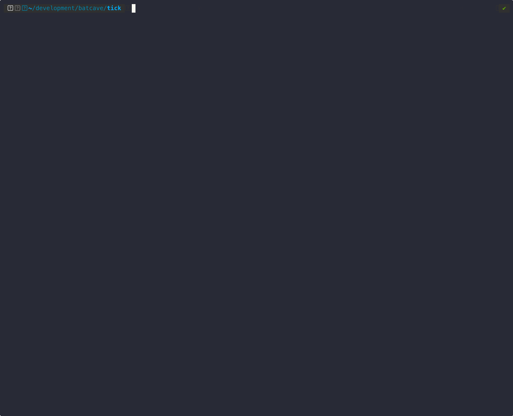

# tick

A simple CLI to track your portfolio from the terminal.



---

## ✨ Features

- 📊 Portfolio tracking (positions, cost basis, PnL)
- ⚡ Daily snapshot view (value, holdings, risk, news)
- ⚠️ Risk insights (concentration, largest positions)
- 📰 Headline-based market news per asset
- 🧾 Import positions from JSON and weekly trades from CSV (`tick trades import`)

---

## 📦 Installation

### Homebrew (recommended)

```bash
brew tap squeakycheese75/tick
brew install tick
brew upgrade tick
```

### From source

```bash
git clone https://github.com/squeakycheese75/tick
cd tick
go build -o tick ./cmd/tick
```

---

## 🚀 Quick start

```bash
tick portfolio create main --base EUR

tick portfolio add BTC   --qty 0.5   --avg-cost 25536.60

tick portfolio add NVDA   --qty 10   --avg-cost 340.49

tick portfolio add MSTR   --qty 10   --avg-cost 120.00

tick portfolio summary

tick daily

tick news NVDA BTC MSTR
```

---

## 📸 Example

### Daily snapshot

```bash
tick daily
```

```text
main  36,283.76 EUR  Δ +6.38 EUR (+0.02%)

Holdings
BTC     91.04%    33,033.29 EUR  @    77,614.00 USD  → +0.00%  Δsnap +6.38 EUR (+0.00%)
NVDA     4.75%     1,723.72 EUR  @       202.50 USD  ↑ +1.31%
MSTR     4.21%     1,526.75 EUR  @       179.36 USD  ↑ +9.39%

Risk   Largest: BTC (91.04%)   Top 3: 100.00%   ! High concentration

News
BTC:  Why did Bitcoin price (BTC USD) and crypto stocks fall today after Fed chair nominee Kevin Warsh's
NVDA: NVIDIA remains central to AI infrastructure demand
```

---

### Portfolio summary

```bash
tick portfolio summary
```

```text
main

Base currency EUR
Total value   36,283.76 EUR
Total cost    17,194.64 EUR
Total PnL     +19,089.12 EUR  (+111.02%)

Positions
TICKER        QTY             PRICE             VALUE              COST                PNL     PNL %
BTC        0.5000     77,614.00 USD     33,033.29 EUR     12,768.30 EUR     +20,264.99 EUR  +158.71%
NVDA      10.0000        202.50 USD      1,723.72 EUR      3,404.88 EUR      -1,681.16 EUR   -49.38%
MSTR      10.0000        179.36 USD      1,526.75 EUR      1,021.46 EUR        +505.28 EUR   +49.47%
```

---

## 🧠 How it works

### `tick daily`
A compact snapshot answering:

> “How is my portfolio doing right now?”

### `tick portfolio summary`
A detailed accounting view answering:

> “What exactly do I hold and how is it performing?”

---

## 🛠 Commands

```bash
tick portfolio create main --base EUR
tick add MSTR --qty 1 --avg-cost 110.00
tick add BTC --qty 0.1 --avg-cost 30000.00
tick add NVDA --qty 10 --avg-cost 400.00

tick portfolio summary
tick portfolio risk

tick daily
tick news BTC MSTR
```

---

## 🧪 Status

Tick is under active development.

---

## 📄 License

MIT

## Importing trades

Apply buys and sells from a CSV file to a portfolio's positions:

```bash
tick trades import --file trades.csv --portfolio trending
```

```csv
date,symbol,side,quantity,price,currency,fee,exchange,instrument_type,quote_currency
2026-10-12,MRNA,buy,1,200,EUR,1,NASDAQ,equity,USD
2026-10-14,DELL,sell,0.5,520,USD,0,NASDAQ,equity,USD
```

- Required columns: `date`, `symbol`, `side` (`buy`/`sell`), `quantity`, `price`, `currency`.
- Optional columns: `fee`, `fx_rate`, `ref`, `exchange`, `instrument_type`, `quote_currency`. Missing instrument details are looked up, as with `tick add`.
- Prices are converted from the trade `currency` to the instrument's quote currency. Set `fx_rate` to use your actual rate; otherwise the current rate is used.
- Buys update the average cost (fees included). Sells reduce the quantity and keep the average cost. Selling everything closes the position.
- The whole file is checked before anything is written, so a bad row (or a sell larger than the holding) imports nothing.
- Re-importing a file is safe: trades already recorded are skipped. Give each trade a `ref` (such as a broker order id) for a reliable identity.
- The portfolio summary splits PnL into "from assets" (the price moving) and "from FX" (the currency rate moving since you bought). This needs the purchase cost in your base currency, which trade import records. Positions without it (added with `tick add`, or imported from JSON) show `-` and no FX split.

## Working with several portfolios

```bash
tick portfolio list              # every portfolio, with its position count; the default is starred
tick portfolio use trending      # make `trending` the default for every command
tick portfolio summary           # now reports on `trending`
tick daily --portfolio main      # a flag still wins for a single command
```

Commands that take `--portfolio` choose in this order: the flag, the `TICK_PORTFOLIO` environment variable, the default set with `tick portfolio use` (stored in `~/.tick/default_portfolio`), then `main`.

When prices come from an earlier day than today (before the market opens, or at a weekend), `summary` and `daily` say so with a line such as `Prices as of Fri 9 Oct`. The day-change percentages in that case are that earlier session's move, not today's.

## Which command?

- `tick portfolio summary`: how you are doing against what you paid. Value, cost, PnL, and how much of the PnL is the assets and how much is FX.
- `tick daily`: what happened today. Holdings, risk, news and anything needing attention. It saves a snapshot, so later runs can show the change since the last one.
- `tick daily --short`: the quick look. Movers ranked by the size of the move, and news. It does not save a snapshot. `tick brief` still works as a hidden alias.

## HTTP API

`tick serve` exposes the same use cases the CLI runs, for scripts and other programs on your machine. It is the CLI's twin, not a separate system: both use the same database and the same rules.

```bash
export TICK_API_TOKEN=$(openssl rand -hex 32)   # or put it in ~/.tick/config.env
tick serve                                       # listens on 127.0.0.1:8080
```

```bash
curl -H "Authorization: Bearer $TICK_API_TOKEN" http://127.0.0.1:8080/v1/portfolios

curl -H "Authorization: Bearer $TICK_API_TOKEN" -H 'Content-Type: application/json' \
  -d '{"trades":[{"ref":"order-1","date":"2026-10-12","symbol":"MRNA","side":"buy","quantity":1,"price":200,"currency":"EUR","fee":1,"exchange":"NASDAQ","instrumentType":"equity","quoteCurrency":"USD"}]}' \
  http://127.0.0.1:8080/v1/portfolios/trending/trades
```

| | |
|---|---|
| `GET /v1/portfolios`, `POST /v1/portfolios` | list, create |
| `POST /v1/portfolios/{name}/trades` | apply buys and sells; all or nothing; safe to retry |
| `GET /v1/portfolios/{name}/summary` | value, cost, PnL split into asset and FX |
| `GET /v1/portfolios/{name}/daily` | holdings, risk, news, attention (`?short=true`, `?newsLimit=`) |
| `GET /healthz` | up check, no token |

Full details are in [`docs/openapi.yaml`](docs/openapi.yaml).

- **Local only.** It refuses to listen on anything but loopback, rejects requests whose `Host` is not `localhost`/`127.0.0.1`/`[::1]`, and will not start without a token of at least 16 characters.
- **Reads change nothing.** `GET .../daily` does not save a snapshot.
- **Errors** are `{"error":{"code","message"}}`: `422` invalid, `404` not found, `409` conflict (including "data changed, send it again"), `502` a price or rate provider is down.
- Ratios (`pnlRatio`, `weight`, `changeRatio`) are fractions: `0.25` is 25%.
